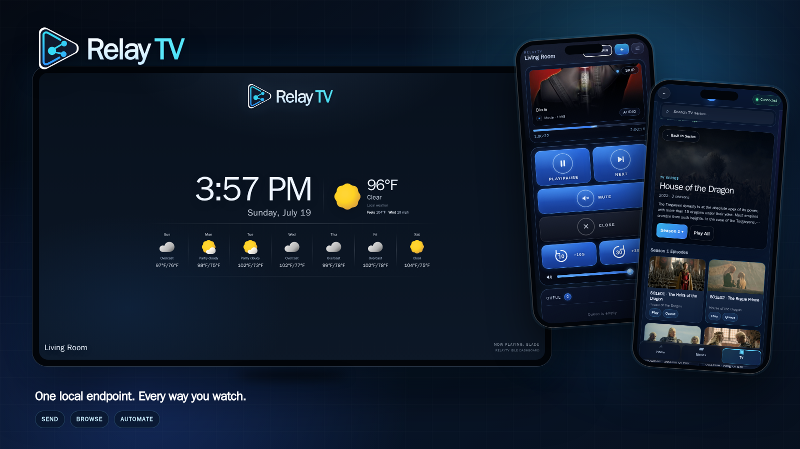
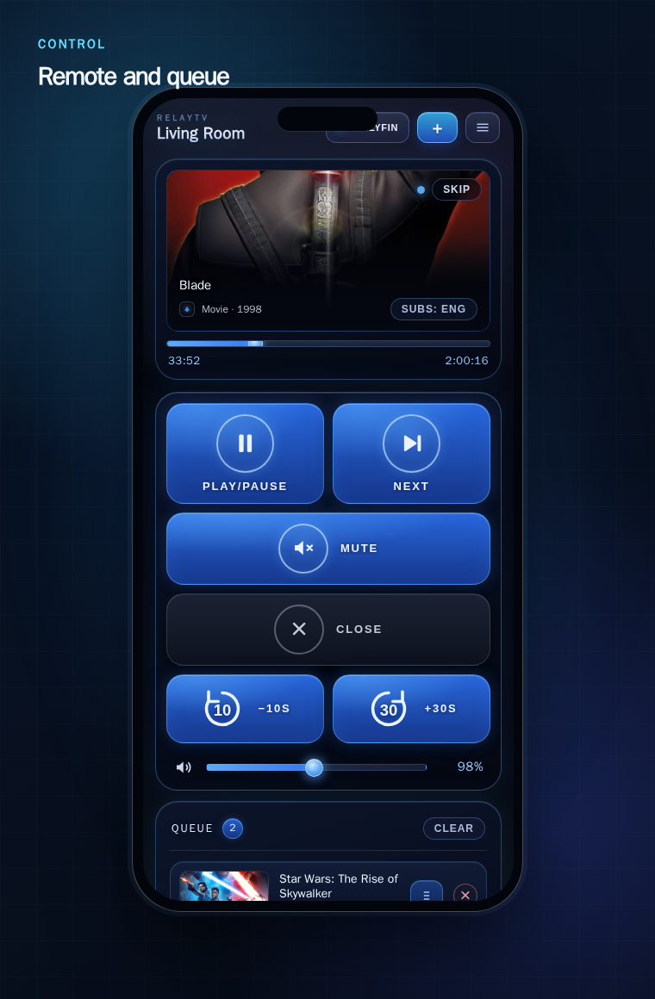
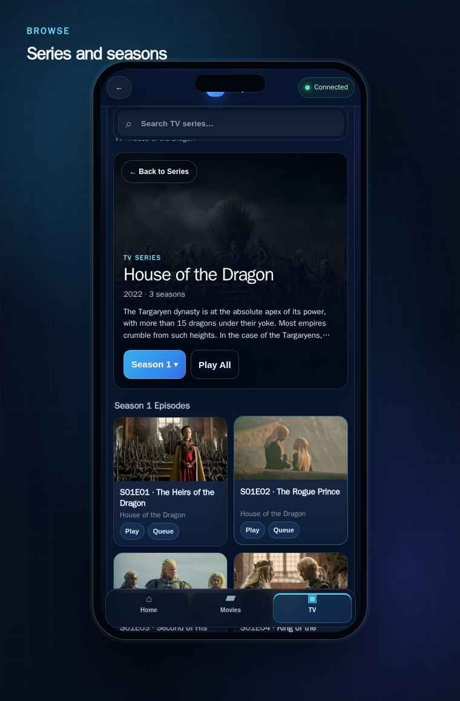
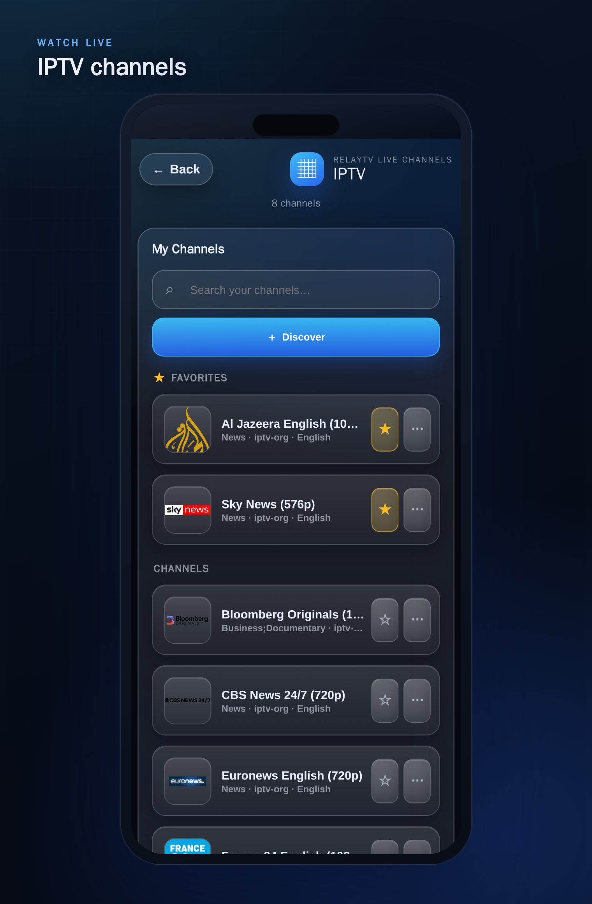
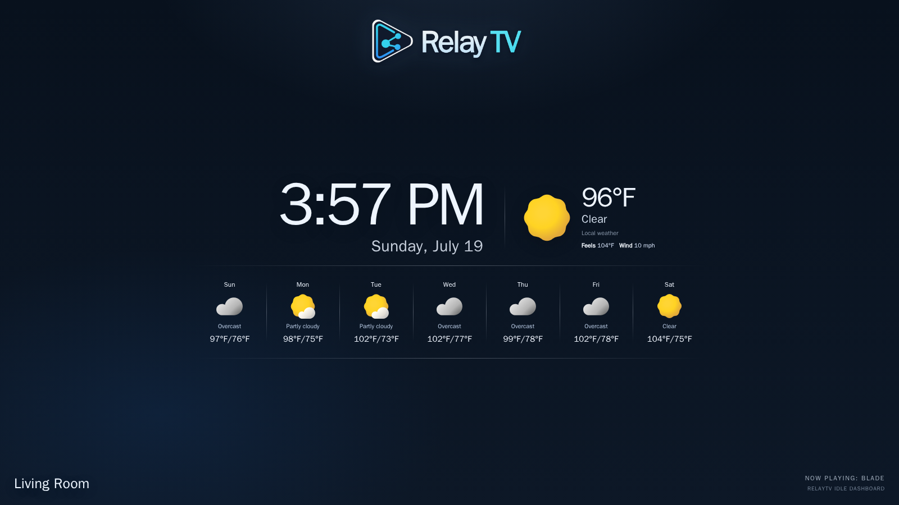

<p align="center">
  
</p>

<h1 align="center">Scan the TV. Pick something to watch.</h1>

<p align="center">
  Turn a Linux box connected to your TV into a self-hosted, local-first media
  hub. Family and guests scan the QR code on the TV to browse your connected
  libraries, play videos, and add to the queue from their phone's browser.
  You connect the services; they choose what to watch.
</p>

<p align="center">
  <a href="#install-in-minutes"><strong>Install RelayTV</strong></a> ·
  <a href="https://relaytv.app/integrations/"><strong>Explore integrations</strong></a> ·
  <a href="https://relaytv.app/docs/"><strong>Read the docs</strong></a>
</p>

<p align="center">
  <a href="https://github.com/mcgeezy/relaytv/actions/workflows/ci.yml"></a>
  <a href="https://github.com/mcgeezy/relaytv/pkgs/container/relaytv"></a>
  <a href="https://github.com/mcgeezy/relaytv-ha"></a>
  <a href="https://github.com/mcgeezy/relaytv-android"></a>
</p>

<p align="center">
  
</p>

<p align="center">
  <strong>Local-first</strong> · No RelayTV account · No app telemetry · No
  cloud dependency for core playback
</p>

## Your media setup, easy for everyone to use

You know where everything lives. Your guests shouldn't have to. RelayTV brings
Plex, Jellyfin, Emby, Seerr, web videos, and live channels into one web interface,
so people can find something to watch without learning each service or
installing its app.

1. **Connect your services once.** Set up the libraries, live sources, and
   optional Seerr requests you want to make available in RelayTV.
2. **Scan the TV's QR code.** On the same local network, family and guests open
   the phone remote directly in their browser. No RelayTV account or companion
   app is needed.
3. **Choose what happens next.** Browse a library, play something on the TV,
   add a pick to the shared queue, or request a movie or series through Seerr
   when requests are enabled.

The QR code opens this TV's RelayTV interface. Available media comes from your
configured services and accounts. Seerr can use shared requests or require
individual sign-in, depending on your setup; if you enable RelayTV's optional
API token, guests also need that token to control playback.

## Play. Browse. Control. Automate.

### ▶️ Play

Paste a media URL into the Web UI, share a link or local audio/video file from
[Android](https://github.com/mcgeezy/relaytv-android), or upload media through
[Home Assistant](https://github.com/mcgeezy/relaytv-ha). Play now, add to the
queue, or resume something from history. Playback runs on the Linux box, so
your phone can leave the remote page while the TV keeps playing. Temporary
playback can interrupt a session and resume it afterward.

### 🎬 Browse

Explore Plex, Jellyfin, or Emby from a responsive library built for phones and
desktops. Search for a movie, browse seasons and episodes, then play now or add
to the queue. Connect Seerr to discover movies and series, request something
missing, and follow its request status. Add IPTV playlists, curate
**My Channels**, and favorite the live sources you use.

### 🎛️ Control

Scan the QR code on the TV's idle screen or open the Web UI from a browser.
Control playback, volume, and the shared queue from your phone. For live streams
with a seekable buffer, rewind within the cached window and jump back to live.
The Android app adds separate Play
and Queue share targets, native media controls, mDNS discovery, and profiles for
multiple RelayTV screens. RelayTV devices can also send a queue or active
playback to one another on the local network.

To queue a YouTube playlist, open **Link**, paste its URL, and choose
**Add entire playlist**. Videos are added in playlist order while current
playback continues. A video link with playlist context also offers the usual
**Play** and **Queue** actions for that individual video. Import status and
cancellation stay available in the Link dialog, including after a reload.
Finite playlists support up to 1,000 videos; private lists need configured
YouTube cookies, and unavailable entries are reported when they can be detected.

### 🏠 Automate

Make every screen a Home Assistant `media_player`, or use the local HTTP API
from scripts, dashboards, services, and agent workflows. Smart play, temporary
media, overlays, snapshots, direct uploads, and synchronized multi-screen starts
all keep the playback engine beside the TV.

## See it in action

<table>
  <tr>
    <td width="50%" valign="top">
      
    </td>
    <td width="50%" valign="top">
      
    </td>
  </tr>
  <tr>
    <td valign="top">
      <h3>Everything you need from the couch</h3>
      Play, pause, seek, change volume, manage the queue, resume history, and
      send something new without taking over the television UI.
    </td>
    <td valign="top">
      <h3>Browse together, without learning the media server</h3>
      Search your connected library, explore series and seasons, and play or
      queue a pick from the phone. Shown here: the Jellyfin/Emby browser.
    </td>
  </tr>
  <tr>
    <td width="50%" valign="top">
      
    </td>
    <td valign="middle">
      <h3>Live TV, curated the way you watch</h3>
      Add M3U playlists or pick from the free-provider directory, then build a
      <strong>My Channels</strong> list, pin favorites to the top, and send a
      live channel to the TV — all from the same phone remote. Rewind within
      the available stream buffer, then jump back to live.
    </td>
  </tr>
</table>

<p align="center">
  
</p>

### The TV keeps playing. Your phone is the remote.

RelayTV runs on the Linux device connected to the display. It owns playback,
queue advancement, history, overlays, and the idle dashboard locally, while
companion apps and automations remain optional ways to control it.

See the [product overview](https://relaytv.app/product/) for the complete system
model and real [cross-device workflows](https://relaytv.app/demo/).

## Install in minutes

RelayTV is built for 64-bit Raspberry Pi-class devices (with dedicated Pi 4 and
Pi 5 hardware profiles), Intel mini PCs, NUCs, HTPCs, and other `amd64` or
`arm64` Linux hosts connected directly to a television. The installer can set up
Docker with your approval when needed.

```bash
mkdir -p ~/relaytv
cd ~/relaytv
curl -fsSL https://raw.githubusercontent.com/mcgeezy/relaytv/main/install.sh | bash
```

Then scan the QR code on the TV's idle screen, or open
`http://YOUR_RELAYTV_HOST:8787/ui` from a phone or desktop browser on the same
network. Open **Settings** to connect your media services. Once configured,
family and guests use that same QR code to browse and control this TV.

Need runtime choices, hardware notes, or an existing source checkout? See the
[complete installation guide](docs/INSTALL.md), or follow the public
[getting-started path](https://relaytv.app/docs/getting-started/).

## Made for the stack you already own

- **[Home Assistant](https://github.com/mcgeezy/relaytv-ha)** — entities,
  services, automations, and dashboard workflows.
- **[RelayTV for Android](https://github.com/mcgeezy/relaytv-android)** — share
  links directly to the TV and control playback from your phone.
- **YouTube and Web Video** — send a video link to the TV, watch live streams,
  and queue videos from supported sites.
- **Plex** — secure account linking and server selection, responsive Home,
  Movies, TV, search, season and episode browsing, media and track choices,
  resume, queue, direct-play, and transcoding workflows.
- **Jellyfin and Emby** — responsive Home, Movies, TV, series, season, episode,
  search, resume, and queue workflows.
- **Seerr** — discover movies and series, request missing titles, and track
  requests. Play available Jellyfin items when RelayTV can match them to your
  connected library. Choose shared requests or individual sign-in.
- **IPTV / M3U** — opt-in live sources, curated My Channels, favorites, and
  availability checks, with rewind and return-to-live controls when the stream
  has a seekable cache. The rewind window is limited to the buffered media;
  this does not record shows for later.
- **HTTP API** — local automation from shell scripts, dashboards, services, and
  custom applications.

The core server does not require a RelayTV cloud account. It is designed for a
trusted LAN; use a VPN or authenticated reverse proxy rather than exposing the
API directly to the public internet. An optional `RELAYTV_API_TOKEN` can protect
control and mutating requests with bearer authentication on shared networks.

## For operators and developers

| Start here | Reference |
| --- | --- |
| [Installation](docs/INSTALL.md) | [HTTP API](docs/API.md) |
| [Native runtime operations](docs/NATIVE_RUNTIME_OPERATIONS.md) | [Jellyfin/Emby operations](docs/JELLYFIN_OPERATIONS.md) |
| [Plex operations](docs/PLEX_OPERATIONS.md) | [IPTV operations](docs/IPTV_OPERATIONS.md) |
| [Seerr operations](docs/SEERR_OPERATIONS.md) | [Device sync operations](docs/DEVICE_SYNC_OPERATIONS.md) |
| [Architecture](docs/ARCHITECTURE.md) | [Release process](docs/RELEASE.md) |
| [Public documentation](https://relaytv.app/docs/) | [Documentation map](docs/README.md) |

The documentation map links the remaining runbooks and machine-checked
inventories.

## Project and support

RelayTV is open-source software licensed under the
[GNU General Public License v3.0](LICENSE). RelayTV artwork and marks are
covered by the [asset and trademark policy](ASSETS.md).

If RelayTV makes your living-room setup better, you can help by
[starring the repository](https://github.com/mcgeezy/relaytv), sharing it with
another self-hoster, or [supporting development](https://buymeacoffee.com/relaytv).
